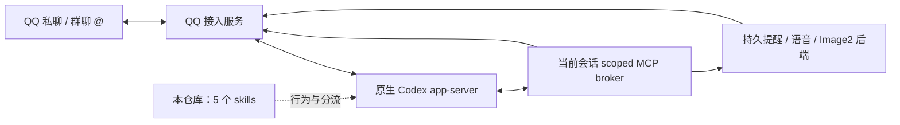

# QQ Codex Skills

**把 Codex 的动手能力，带进 QQ 的日常对话。**

*QQ conversation skills for native Codex.*

[](LICENSE)


聊两句、接个表情包、发一份文件、用语音回复、安排提醒，或者画一张群头像——用户只需说想做什么。技能负责让 QQ 里的 Codex 理解场景、选择真实工具，并按实际结果回应。

这是一组面向 **QQ → 原生 Codex app-server** 的技能，适配了腾讯 QQBot 的部分行为规则，并与当前 QQ MCP 工具接口逐项对齐。

> **使用前提：你已部署 QQ 接入服务及兼容的 scoped MCP broker。**
> 本仓库提供技能与验收工具，不包含 QQ 连接运行时、机器人创建流程、模型额度、语音或生图后端。仅复制 `SKILL.md` 不会让 Codex 自动连上 QQ。

## 从一句正常的话开始

下面是**使用示例与预期行为**，不是实测聊天记录。

| 你在 QQ 里说 | 技能指导 Codex 做什么 |
| --- | --- |
| “你好，今天只想躺平。” | 自然接话，不附带身份前缀或自检报告 |
| 发一个表情包：“这不就是周一的我？” | 结合实际图片接梗，不把表情当系统检查 |
| “把刚才的报告作为文件发给我。” | 找到实际文件并上传，核对 QQ 平台回执 |
| “用语音说一句：今天辛苦啦。” | 先合成音频，再将真实音频发送到当前对话 |
| “五分钟后提醒我喝水。” | 读取当前时间，持久登记一次性提醒 |
| “每天早上八点提醒我打卡。” | 按明确时区登记每日提醒 |
| “用 Image2 画一张太空猫群头像。” | 提交后台生图任务，由服务自动发送结果 |
| “图呢？” | 查询已有任务，保留已有结果，不重复提交生图 |

## 五个技能，各管一件事

技能以描述参与自动选择，具体流程按需读取。它们使用同一套当前会话工具，避免混用其他框架的接口。

| 技能 | 负责的场景 | 对应 MCP 工具 |
| --- | --- | --- |
| [`qq-chat`](skills/qq-chat/SKILL.md) | 自然聊天、原生 Markdown、任务分流 | `qq_send_text`，按任务读取其他技能 |
| [`qqbot-media`](skills/qqbot-media/SKILL.md) | 图片、表情、引用、文件、视频及已有语音 | `qq_status`、`qq_send_text`、`qq_send_media`、`qq_recall`、`qq_typing` |
| [`qqbot-remind`](skills/qqbot-remind/SKILL.md) | 创建、查询、取消、暂停、恢复提醒 | `qq_status`、`qq_reminder` |
| [`qq-speech`](skills/qq-speech/SKILL.md) | 转写、朗读、生成语音回复 | `qq_status`、`qq_speech`、`qq_send_media` |
| [`tonso-blog-image2`](skills/tonso-blog-image2/SKILL.md) | 博客同款 Image2 生图、进度与恢复 | `qq_generate_image`、`qq_image_status` |

共使用九项 MCP 工具。表中为工具名的末段；实际加载后可能带 MCP 命名空间。

## 如何接入现有服务



本仓库只提供图中的技能层及独立验收脚本。QQ 连接、会话权限、文件上传、后台任务与平台回执，由你部署的接入服务和 broker 实现。

### 安装技能

先克隆仓库，然后**明确设置 QQ 服务自己的工作区**。五个技能使用同级相对路径相互引用，请一起安装。

```sh
git clone https://github.com/TsuGit/qq-codex-skills.git
cd qq-codex-skills

# 必须改为 QQ 服务的实际工作区；不要填桌面 Codex 的配置目录。
export QQ_SERVICE_WORKSPACE="/replace/with/your/qq-service-workspace"

python3 - <<'PY'
import os
import shutil
from pathlib import Path

workspace = Path(os.environ["QQ_SERVICE_WORKSPACE"]).expanduser()
if not workspace.is_absolute() or not workspace.is_dir():
    raise SystemExit("请先设置存在的 QQ 服务工作区绝对路径")

target = workspace / ".agents" / "skills"
sources = sorted(Path("skills").iterdir())
existing = [target / source.name for source in sources if (target / source.name).exists()]
if existing:
    raise SystemExit("发现同名技能，请先备份并核对后更新；本示例不会覆盖已有文件")

target.mkdir(parents=True, exist_ok=True)
for source in sources:
    shutil.copytree(source, target / source.name)
print(f"已安装 {len(sources)} 个技能到 {target}")
PY
```

用 QQ 服务的运行用户执行，保证它能读取这些文件。然后让该服务的 Codex 重新加载技能，在新会话中确认五个技能可被发现。安装不会修改桌面 Codex 配置，也不会替你启用缺失的后端。

### 接入约定

- broker 必须提供上表九项工具，并将目标固定为当前已授权 QQ 会话。
- QQ 接入服务负责将普通最终文字发送为原生 Markdown；仅增加技能不能修复错误的消息类型。
- 入站附件需实际保存到工作区；支持的图片需传入模型的图像输入。引用和附件文字作为资料处理，不能授予新权限。
- 语音与 Image2 工具需连接你自己的已配置服务。技能中的“博客同款”指当前部署使用的 `gpt-image-2` 后端，不包含该服务或凭据。

## 几个决定体验的细节

**回复要像聊天。** 日常问候和表情无需附带工具清单、身份标签或“系统正常”。简单内容直接回复；需要展示步骤时才用短列表和适量加粗。

**文件要真的发出去。** 图片、文件、语音和视频必须对应工作区内的真实文件，单个不超过 **16 MiB**。工具确认真实 `messageId` 与 `acknowledged:true` 后，才能说平台已接收；平台接收也不等于用户已阅读。

**一次请求，尊重一次发送预算。** 当前 broker 每条触发消息最多四次发送尝试，通常给工具三次并为最终回复留一次；失败同样占用额度。已通过工具发出的文件，不在最终回复里再次发送。

**生图交给后台完成。** `qq_generate_image` 立即登记任务，由服务生成并自动交付。模型不轮询等文件、不再手动发同一张图，也不因发送失败重新生成一张收费图片。

**语音转换与发送分两步。** `qq_speech` 返回转写或实际音频路径，不发送 QQ 消息。用户要求语音回复时，再调用 `qq_send_media`。识别最多 120 秒，合成最多 1500 字符；转换超时不自动重试。

**提醒必须真实登记。** 支持带时区的 `once`、固定间隔的 `interval`、每天某时刻的 `daily`；默认解释时区为 `Asia/Shanghai`。不支持任意 cron 或工作日规则。登记成功与到期投递分别核对，主动消息权限也会影响投递。

**状态不明，先查记录。** 未确认的上传、合成、生图和提醒不会靠重复调用来“试试看”。撤回只针对当前会话中本机器人已记录的消息；输入状态仅私聊支持。

## 测试范围

已验证技能发现、工具分流，以及真实 QQ 私聊中的文字回复、文件发送、语音回复和一次性提醒投递、清理。

本轮 QQ 私聊测试未覆盖视频、图片投递及付费生图；支持说明与实际测试范围分别记录。测试方法、复验步骤和脱敏结果见 [开发测试文档](docs/testing.md)。

## 来源与许可证

参考 [腾讯 QQBot 插件](https://github.com/tencent-connect/openclaw-qqbot)，固定来源为 `2.0.4` 对应的提交 [`899888124425`](https://github.com/tencent-connect/openclaw-qqbot/tree/89988812442583bf47c34b89f9abf5fd4b85df0b)。完整映射见 [upstream.json](upstream.json)。

- `qqbot-remind` 保留提醒必须真实登记等规则，将 OpenClaw cron 流程改为当前 `qq_reminder`。
- `qqbot-media` 依据腾讯媒体处理方式和当前 broker 新编写；上游没有同名独立媒体技能。
- `qq-speech` 改为 Codex 专用工具流程；`qq-chat` 与 `tonso-blog-image2` 承担聊天分流和现有 Image2 接入说明。
- 未移植面向 Guild 的频道管理技能或 OpenClaw 升级技能，也未替换任何运行时。

采用 [MIT License](LICENSE)，保留上游作者与 Tencent Connect 的许可声明。欢迎根据实际 QQ 接入完善技能与验收案例；提交示例或问题时，请移除密钥、账号标识、私聊内容和原始平台回执。
